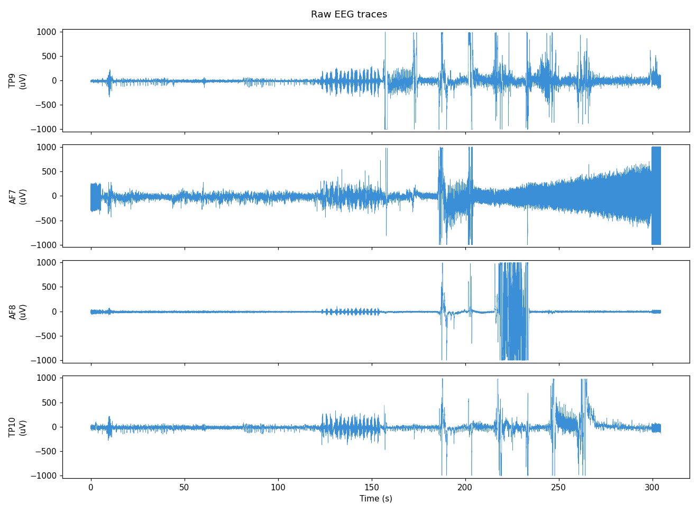
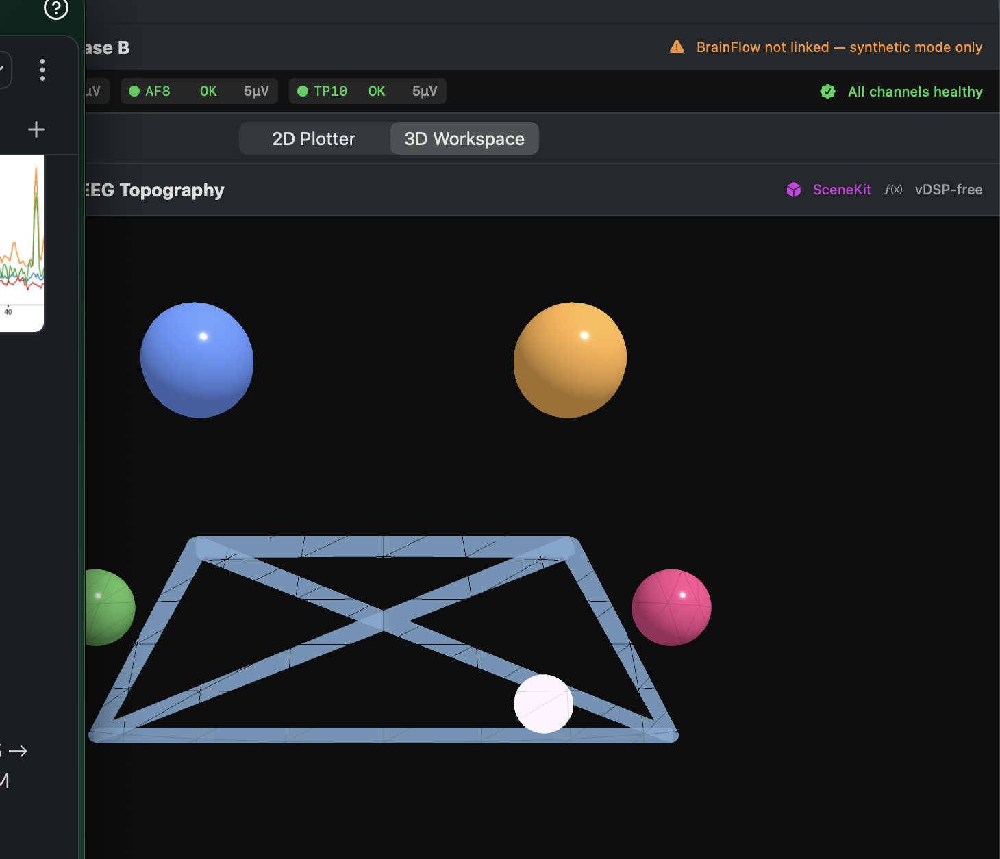

# NeuralCompose

NeuralCompose is a privacy-oriented macOS research prototype for EEG-driven communication, signal visualization, semantic composition, and sleep-cycle experimentation.

A Muse headband can feed four-channel EEG into a Swift pipeline for acquisition, windowing, signal-quality checks, intent classification, semantic visualization, text generation, and speech. The repository also includes deterministic synthetic and playback modes, offline evaluation tools, and experimental dialectical dialogue loops.

> **Research prototype:** NeuralCompose is not a medical device and must not be used for diagnosis, treatment, safety-critical communication, or clinical decisions.

## What runs where

| Component | Default location |
|---|---|
| SwiftUI application and visualization | Mac |
| EEG acquisition and preprocessing | Mac |
| Core ML classifiers and embeddings | Mac / Apple Neural Engine when available |
| MLX models | Mac / Apple Silicon GPU when configured |
| Ollama generation | Configured Ollama server, commonly the same Mac |
| Claude generation | Anthropic through the locally installed Claude Code CLI |
| Interaction logs and research artifacts | Local filesystem |

Most of the application can run without hardware, model weights, Ollama, Claude, or BrainFlow. The synthetic stream and deterministic fallbacks are the recommended first launch.

Cloud generation is opt-in. Selecting the Claude runtime sends prompt text through the authenticated Claude Code CLI. NeuralCompose records the requested and resolved runtime identity so local and cloud execution are not presented as interchangeable.

## Live signal

<p align="center">
  
  
</p>

The committed golden recording contains TP9, AF7, AF8, and TP10 data from a Muse S. It supports deterministic regression tests of playback, windowing, feature extraction, channel health, and visualization behavior. See [`Recordings/golden/README.md`](Recordings/golden/README.md).

## Requirements

### Minimum local build

- macOS 14 or newer
- Apple Silicon recommended
- Git
- Swift 6 toolchain
- Xcode Command Line Tools

Install the command-line tools when necessary:

```bash
xcode-select --install
```

Confirm the toolchain:

- `BCICore` — pure-Swift models, protocols, FSMs, buffers. **No third-party deps.**
- `BCIBridge` — Obj-C++ shim for BrainFlow (stub by default, gated by `BCI_BRAINFLOW_AVAILABLE`).
- `BCIEEG` — `BrainFlowService`, `SyntheticEEGStream`, `PlaybackEEGStream`, `EEGScalpPlotterView`, `NeuralWorkspaceView`.
- `BCIClassifier` — Core ML wrapper + deterministic mock (also the CI classifier); also hosts `CoreMLSentenceEmbedder` + `WordPieceTokenizer` for real semantic embeddings.
- `BCILLM` — **MLX-Swift linked only here.** Adapter + stub + tokenizer.
- `NeuralComposeApp` — SwiftUI views, Phase B debug window, menu-bar UI.
- `EmbeddingBench` — sibling executable (not part of the app) that benchmarks any `SentenceEmbedder` conformer; knows nothing about Core ML or MLX.

The app talks to `BCILLM` through `NextWordPredicting`, so there's exactly
**one** MLX runtime copy in the linked binary.

Related architecture notes:

- [Three Orthogonal Concerns](docs/architecture/three-orthogonal-concerns.md)
  separates Science, Engineering, and Computation.
- [Engineering Runtime](docs/architecture/engineering-runtime.md)
  scopes bounded implementation backends.
- [Julia Science Workspace](docs/architecture/julia-science-workspace.md)
  keeps Julia as an offline scientific laboratory, not an app runtime.
- [NeuralComposeEEG](NeuralComposeEEG/README.md) defines a separate,
  shadow-only four-channel Muse encoder benchmark with complete-session splits;
  it has no Swift or live-control dependency.
- [EEG Mathematics, Physics, and Methods Scope](docs/scoping/eeg-mathematics-physics-methods-scope.md)
  keeps the current encoder work grounded in the necessary linear-algebra,
  signal-processing, and evaluation foundations while deferring forward models
  and policy/control theory to later falsifiable experiments.
- [State Reconstruction Goal 0](docs/science/state-reconstruction-goal-0.md)
  and [Trajectory Analysis Goal 1](docs/science/trajectory-analysis-goal-1.md)
  turn soak telemetry into falsifiable science artifacts.
- [Sobolev and ZPD Hypotheses](docs/science/sobolev-zpd-hypotheses.md)
  places smooth dynamics and proximal intervention as falsifiable research claims.
- [Symbolic Systems as Hypothesis Sources](docs/science/symbolic-systems-hypothesis-sources.md)
  keeps traditions like geomancy as testable abstractions, not runtime modes.
- [Semantic-to-Prosody Boundary](docs/architecture/semantic-to-prosody-boundary.md)
  separates what text is generated from how it is spoken.
- [Prosody Feature Contract](docs/architecture/prosody-feature-contract.md)
  defines the cadence fields that Engineering can measure and Science can model.
- [Prosody MVP Experiment](docs/experiments/prosody-mvp-001.yaml)
  preregisters the first cadence hypothesis:
  [reflective_prosody_v1](docs/hypotheses/reflective_prosody_v1.yaml).

### Rust Phase 0

`Rust/prosody_features` is the first deterministic measurement crate.
It is not wired into the Swift runtime. It measures mono audio into
prosody features that can later feed telemetry contracts:

```bash
cd Rust/prosody_features
cargo test
```

### Four-layer model

The codebase is organized into four layers, named for *role* (not
current contents) so they remain meaningful as the platform grows:

```
┌─────────────────────────────────────────────────────┐
│                      Interface                      │
│  SwiftUI · SceneKit · Plotters · Channel-health UI  │
└────────────────────────▲────────────────────────────┘
                         │ depends on
┌────────────────────────┴────────────────────────────┐
│                     Intelligence                    │
│  DSP · Features · Classifier · Embeddings · Project │
└────────────────────────▲────────────────────────────┘
                         │ depends on
┌────────────────────────┴────────────────────────────┐
│                      Runtime                        │
│  EEGStreaming · AsyncMulticastChannel · Supervisors │
│  Recording · Diagnostics                            │
└────────────────────────▲────────────────────────────┘
                         │ depends on
┌────────────────────────┴────────────────────────────┐
│                  External Systems                   │
│   Muse · BrainFlow · OSC · Playback · Synthetic     │
└─────────────────────────────────────────────────────┘

  ▼ data flows downward
```

### Full local feature build

Install the full Xcode application when using MLX GPU execution, Metal kernels, app signing, or Xcode-based builds.

After installing Xcode:

```bash
sudo xcode-select -s /Applications/Xcode.app/Contents/Developer
sudo xcodebuild -license accept
xcodebuild -version
```

Optional external systems:

- **BrainFlow** for direct Muse acquisition
- **Ollama** for local HTTP generation
- **Claude Code CLI** for the opt-in Anthropic runtime
- Converted Core ML and MLX model artifacts under `Models/`

## Clone

```bash
git clone https://github.com/aurascoper/NeuralCompose.git
cd NeuralCompose
```

The commands below assume the repository root is the current directory.

## Fastest local launch: synthetic mode

Synthetic mode needs no Muse, BrainFlow installation, external model weights, Ollama daemon, or Claude login.

```bash
./Scripts/build.sh
./Scripts/run-synthetic.sh
```

`run-synthetic.sh` launches the SwiftPM executable with:

```text
NEURALCOMPOSE_BOARD_PROFILE=synthetic
```

You can also launch it directly:

```bash
NEURALCOMPOSE_BOARD_PROFILE=synthetic \
  swift run -c debug NeuralCompose
```

## Build commands

### Debug

```bash
./Scripts/build.sh
```

Equivalent SwiftPM command:

```bash
swift build -c debug
```

Bare executable:

```bash
.build/debug/NeuralCompose
```

### Release

```bash
./Scripts/build.sh --release
```

Bare executable:

```bash
.build/release/NeuralCompose
```

### Clean rebuild

```bash
swift package clean
rm -rf .build
./Scripts/build.sh
```

Removing `.build` also removes cached dependencies and packaged application bundles, so the next build takes longer.

## Build a launchable macOS application bundle

A bare SwiftPM executable is sufficient for synthetic development. Bluetooth, microphone, and speech-recognition paths should run through the packaged `.app`, because macOS privacy services read their usage descriptions from the bundle’s `Info.plist`.

Build and package a debug application:

```bash
./Scripts/build.sh
./Scripts/package-app-bundle.sh
```

The resulting executable is:

```bash
APP_BIN="$PWD/.build/NeuralCompose.app/Contents/MacOS/NeuralCompose"
```

Verify it:

```bash
test -x "$APP_BIN" && echo "NeuralCompose app executable is ready"
codesign --verify --deep --strict "$PWD/.build/NeuralCompose.app"
```

Launch the packaged app directly so environment variables reach the process:

```bash
NEURALCOMPOSE_BOARD_PROFILE=synthetic "$APP_BIN"
```

Do not use `open NeuralCompose.app` when testing environment-selected runtimes; Launch Services does not reliably preserve shell environment variables.

### Release application bundle

```bash
./Scripts/build.sh --release
./Scripts/package-app-bundle.sh --release

APP_BIN="$PWD/.build/NeuralCompose.app/Contents/MacOS/NeuralCompose"
"$APP_BIN"
```

The packaging script applies an ad-hoc signature. Distribution outside the development Mac requires an Apple Developer signing, notarization, and release workflow that is not provided by the local script.

## Select a generation runtime

Set `APP_BIN` after packaging:

```bash
APP_BIN="$PWD/.build/NeuralCompose.app/Contents/MacOS/NeuralCompose"
```

### Claude through Claude Code

Prerequisites:

```bash
claude --version
claude login
```

Launch:

```bash
env \
  NEURALCOMPOSE_RUNTIME=claude \
  NEURALCOMPOSE_MODEL=claude-sonnet-5 \
  "$APP_BIN"
```

This is a cloud path. The executable is local, but generation is brokered through the authenticated Claude Code service. If Claude is configured but cannot generate, the runtime fails closed rather than silently switching providers.

### Ollama

Install and start Ollama using its normal macOS installation, then pull the requested model:

```bash
ollama pull qwen2.5:0.5b
ollama list
```

Launch:

```bash
env \
  NEURALCOMPOSE_RUNTIME=ollama \
  NEURALCOMPOSE_MODEL=qwen2.5:0.5b \
  "$APP_BIN"
```

The runtime performs a bounded readiness check and requires the requested model to be available. A missing model disables the loop; it does not substitute Claude.

### Runtime troubleshooting

Check the executable and dependencies first:

```bash
printf 'APP_BIN=%s\n' "$APP_BIN"
test -x "$APP_BIN"
claude --version 2>/dev/null || true
ollama list 2>/dev/null || true
```

Run the packaged process from a terminal to retain stderr and structured runtime diagnostics.

## MLX and Metal kernels

The ordinary SwiftPM build is sufficient for synthetic mode, deterministic tests, stub predictors, and most development. A real MLX GPU path needs Metal shaders compiled by the full Xcode toolchain.

Build with Xcode:

```bash
./Scripts/build-xcode-mlx.sh
```

Build and run the MLX smoke path:

```bash
./Scripts/build-xcode-mlx.sh --smoke
```

Release configuration:

```bash
./Scripts/build-xcode-mlx.sh --release
```

The script writes Xcode products under:

```text
.build/xcode/Build/Products/
```

After an Xcode MLX build, package the normal SwiftPM app again when you need `.build/NeuralCompose.app`. `package-app-bundle.sh` searches the Xcode products for `mlx-swift_Cmlx.bundle` and includes it when a compiled `default.metallib` is available.

If packaging reports:

```text
no mlx-swift_Cmlx.bundle with a metallib found
```

the app still launches, but the affected MLX spectral path falls back to its stub.

## Muse and BrainFlow

The default build compiles the BrainFlow bridge in stub mode. Direct Muse acquisition requires a compatible BrainFlow checkout or installation.

The build script searches in this order:

1. `--brainflow-path=<path>`
2. `~/Developer/brainflow`
3. `brew --prefix brainflow`

Example:

```bash
./Scripts/build.sh \
  --with-brainflow \
  --brainflow-path="$HOME/Developer/brainflow"

./Scripts/package-app-bundle.sh
APP_BIN="$PWD/.build/NeuralCompose.app/Contents/MacOS/NeuralCompose"
```

Launch the provided Muse script when its assumptions match your installation:

```bash
./Scripts/run-muse-s.sh
```

Bluetooth access must be granted to the packaged application. A bare executable can be terminated by macOS privacy enforcement before the application can surface a normal error.

See [`HARDWARE_SETUP.md`](HARDWARE_SETUP.md) for board setup and [`TROUBLESHOOTING.md`](TROUBLESHOOTING.md) for acquisition failures.

## Playback

Launch a recorded session through the playback profile:

```bash
./Scripts/run-synthetic.sh \
  --profile playback \
  --recording Recordings/golden/golden_20260710-141352.eeg.csv
```

Analyze the golden recording:

```bash
python3 Scripts/analyze-eeg-session.py \
  Recordings/golden/golden_20260710-141352.eeg.csv
```

## Tests

Run all Swift tests:

```bash
swift test
```

Run the deterministic golden-recording regression:

```bash
swift test --filter GoldenRecordingRegressionTests
```

## macOS packaging

Create a relocatable release bundle, then a drag-to-Applications disk image:

```bash
./Scripts/package-macos-app.sh
./Scripts/create-dmg.sh
```

The artifacts are written to `dist/NeuralCompose.app` and
`dist/NeuralCompose-<version>.dmg`. The bundle includes the app metadata,
icon, SwiftPM resource bundles, and any dynamic libraries produced by a
BrainFlow-enabled build. Both scripts use ad-hoc signing by default for local
use; pass `--sign 'Developer ID Application: ...'` when preparing a signed
distribution. See each script's `--help` output for build and output options.

Before distributing beyond the development machine, launch the bundle itself
and manually confirm permissions, Personal Voice, model/resource discovery,
telemetry location, runtime selection, and `neuralcompose://` routing.

## Experimental status & limitations

```bash
swift test --filter NeuralComposeAppTests
swift test --filter BCICloudBridgeTests
swift test --filter DialecticSessionTests
```

List discovered tests when validating CI filters:

```bash
swift test list
```

Run repository Python contracts when their dependencies are installed:

```bash
python3 -m pytest -q Tests/eval
python3 -m unittest discover -s NeuralComposeEEG/tests -t .
```

Before committing:

```bash
git diff --check
swift build
```

Some MLX, Core ML, live network, hardware, and operator-attended tests are intentionally environment-dependent. A green deterministic suite does not prove Muse connectivity, provider authentication, microphone authorization, or real model execution.

## Useful environment variables

| Variable | Purpose |
|---|---|
| `NEURALCOMPOSE_BOARD_PROFILE` | Selects `synthetic`, playback, OSC, or a supported live board profile |
| `NEURALCOMPOSE_PLAYBACK_PATH` | Recording used by playback mode |
| `NEURALCOMPOSE_RUNTIME` | Selects generation runtime, currently `claude` or `ollama` on the packaged runtime path |
| `NEURALCOMPOSE_MODEL` | Requested model identity |
| `NEURALCOMPOSE_INTERACTION_LOG` | Enables opt-in local interaction logging when supported by the selected path |
| `NEURALCOMPOSE_BIOFEEDBACK_OSC` | Biofeedback egress over OSC: `1` for loopback on UDP 7000, a bare port for loopback on that port, or `host:port` for a LAN destination. Absent, `0` or malformed: off |
| `NEURALCOMPOSE_BIOFEEDBACK_MIDI` | `1` creates the CoreMIDI virtual source "NeuralCompose Biofeedback" (in-machine, no network) |
| `NEURALCOMPOSE_BIOFEEDBACK_RAW_EEG` | `1` re-broadcasts raw `/muse/eeg` over OSC. Ignored without OSC; MIDI cannot carry it |
| `NEURALCOMPOSE_BIOFEEDBACK_PER_CHANNEL` | `1` sends four floats per band (one per channel) instead of the single healthy-channel average |
| `NEURALCOMPOSE_BIOFEEDBACK_MAPPINGS` | Path to a JSON array of `BiofeedbackMapping` routes. Optional; without it only the Mind Monitor mirror runs |

Environment variables configure a launch; they are not durable application preferences. Start a new process after changing them.

## Biofeedback out (OSC and CoreMIDI)

Off by default. When enabled (ADR-011, `decision_registry.md` entry 10), `BCIBiofeedback` turns each EEG window into a `BiofeedbackFrame` of derived features and sends them to music and visual tools: per-channel band powers, per-channel contact quality, the Track A blink and jaw clench events, and IMU readings when the transport has them. Raw EEG never leaves the process unless you pass the explicit raw toggle, and then only over OSC.

```bash
./Scripts/run-biofeedback-osc.sh                         # synthetic EEG -> OSC loopback 7000 (dry run, no hardware)
./Scripts/run-biofeedback-osc.sh --board muses           # live Muse S over BLE
./Scripts/run-biofeedback-osc.sh --board osc --port 7000 # Mind Monitor in (UDP 5000) -> features out (7000)
./Scripts/run-biofeedback-osc.sh --host 192.168.1.20     # send to another machine on the LAN
./Scripts/run-biofeedback-osc.sh --midi                  # also create the "NeuralCompose Biofeedback" MIDI source
./Scripts/run-biofeedback-osc.sh --per-channel           # 4 floats per band instead of 1 average
./Scripts/run-biofeedback-osc.sh --mappings ~/maps.json  # load a [BiofeedbackMapping] JSON set
./Scripts/run-biofeedback-osc.sh --raw-eeg               # explicit raw /muse/eeg re-broadcast
```

The script only exports the five `NEURALCOMPOSE_BIOFEEDBACK_*` variables above and runs the app; set them yourself for any other launch path.

**Mind Monitor-compatible addresses.** `MindMonitorMirror` speaks Mind Monitor's OSC scheme so a consumer written for it (the Muse Port Max for Live device, TouchDesigner, SuperCollider, Bitwig's OSC input) can be pointed at NeuralCompose unchanged:

| Address | Payload |
|---|---|
| `/muse/elements/delta_absolute`, `theta_absolute`, `alpha_absolute`, `beta_absolute`, `gamma_absolute` | 1 float (average over healthy channels) or, with `--per-channel`, 4 floats; Bels |
| `/muse/elements/horseshoe` | 4 floats, 1 good / 2 medium / 4 bad |
| `/muse/elements/blink`, `/muse/elements/jaw_clench` | 1 int, sent only on the event tick |
| `/muse/acc`, `/muse/gyro` | 3 floats (g, deg/s) when the frame has them |
| `/muse/eeg` | raw samples, only with `--raw-eeg` |

Not mirrored: `/muse/batt` and `/muse/elements/touching_forehead` (neither reaches the frame; the horseshoe carries contact quality). Mirror values are not health gated, exactly as Mind Monitor's are not: the consumer gets the horseshoe and decides.

**Custom mappings.** A `BiofeedbackMapping` routes one feature through shaping (linear or log10 normalisation into 0 to 1, smoothing) to an output of your choice: an OSC address of your own with one float, a MIDI control change (7 or 14 bit) or a MIDI note gate for blink and jaw clench. Every mapping carries a `HealthPolicy` for the electrode under it (dead, saturated, stale), which is the difference from feeding Mind Monitor straight into a DAW. The virtual MIDI source appears in Ableton Live, Logic, Reaper and friends as "NeuralCompose Biofeedback".

**Privacy.** Loopback (`127.0.0.1`, the default) and MIDI never leave the machine; the privacy banner shows them in orange. Any other host is a LAN destination over unauthenticated UDP, shown in red along with the raw EEG toggle; keep it on a private network. The badge is hidden while the feature is off. The OSC port here is an outbound port and is separate from the inbound Mind Monitor listener; see `HARDWARE_SETUP.md`, "Outbound biofeedback OSC and Mind Monitor port separation".

## Architecture

```text
NeuralComposeApp
  ├── BCICore          pure-Swift models, protocols, actors, FSMs, buffers
  ├── BCIEEG           synthetic, playback, OSC, BrainFlow, health, visualization
  ├── BCIClassifier    Core ML classifier and sentence-embedding implementations
  ├── BCILLM           isolated MLX runtime and deterministic fallbacks
  ├── BCIVoice         speech recognition and synthesis seams
  ├── BCICloudBridge   explicit opt-in generation egress
  ├── BCIBiofeedback   opt-in OSC and CoreMIDI egress of derived EEG features (ADR-011)
  └── WorldModelDemo   synthetic-task research demo, separate from live EEG claims
```

Load-bearing boundaries:

- `BCICore` owns portable interfaces and deterministic mechanisms.
- MLX imports are isolated to `BCILLM`.
- Cloud generation is isolated to `BCICloudBridge`.
- Biofeedback egress is isolated to `BCIBiofeedback`: derived features only, off by default, loopback by default.
- The interface consumes resolved runtime and pipeline state rather than inventing provider or locality claims.
- Synthetic research demos do not imply validation on physical EEG.

See:

- [`docs/Architecture.md`](docs/Architecture.md)
- [`docs/architecture/PRINCIPLES.md`](docs/architecture/PRINCIPLES.md)
- [`docs/architecture/decision-log/`](docs/architecture/decision-log/)
- [`docs/Math.md`](docs/Math.md)
- [`docs/Research.md`](docs/Research.md)

## Repository layout

```text
NeuralCompose/
├── Sources/
│   ├── BCIBridge/
│   ├── BCICore/
│   ├── BCIEEG/
│   ├── BCIClassifier/
│   ├── BCILLM/
│   ├── BCIVoice/
│   ├── BCICloudBridge/
│   ├── BCIBiofeedback/
│   ├── NeuralComposeApp/
│   ├── DialecticSession/
│   └── WorldModelDemo/
├── Tests/
├── Scripts/
├── NeuralComposeEEG/
├── Evaluation/
├── Recordings/
├── Models/
├── WorldModel/
├── docs/
└── paper/
```

## Current evidence boundary

Established engineering capabilities include deterministic playback, synthetic-mode operation, local pipeline instrumentation, real Muse recording workflows, Core ML integration, and runtime provenance mechanisms.

The following remain research questions or environment-dependent capabilities:

- reliable decoding of intended communication from consumer EEG;
- research-grade sleep staging from four Muse channels;
- sustained behavioral differences among dialogue profiles;
- cognitive-incubation or dream-analysis benefits;
- generalization of synthetic world-model findings to physical EEG;
- production-quality accessibility or medical use.

Documentation and telemetry should preserve the difference between an implemented pipeline, a successful local run, and scientific evidence.

## Additional documentation

- [`HARDWARE_SETUP.md`](HARDWARE_SETUP.md)
- [`MODEL_SETUP.md`](MODEL_SETUP.md)
- [`CALIBRATION.md`](CALIBRATION.md)
- [`TROUBLESHOOTING.md`](TROUBLESHOOTING.md)
- [`SLEEP_CYCLE_DESIGN.md`](SLEEP_CYCLE_DESIGN.md)
- [`Recordings/golden/README.md`](Recordings/golden/README.md)

## Citation

A paper draft is available under `paper/`. Suggested citation when published:

> Kinder, H. (2026). *An open-source, privacy-preserving platform for EEG-guided cognitive incubation and dream-report analysis using consumer-grade hardware.* In preparation.

## License

MIT. See [`LICENSE`](LICENSE).

Research prototype code. Do not use NeuralCompose to make clinical or safety-critical decisions.

## Acknowledgements

- BrainFlow for the unified biosensor acquisition API
- MLX-Swift for Apple Silicon model execution
- Apple Core ML and the Neural Engine
- The Muse developer community
- Open-source EEG and sleep-research communities
